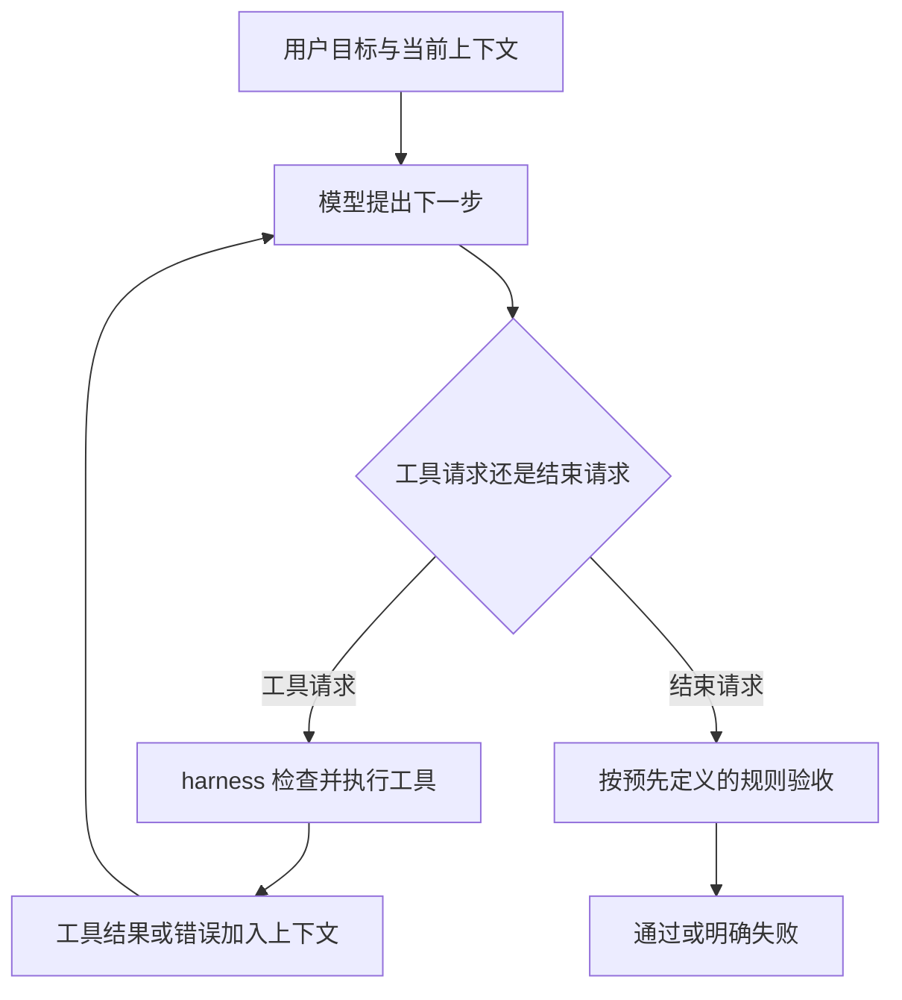

# 从 0 到 1：自己的 Agent 与 harness

目标：边写边理解一个本地文件／编程助手，从最小执行循环逐步走到真实模型、上下文管理、失败恢复和评估。

当前阶段：**第 1 课，模拟模型下的 harness 实验**。使用 Python 3.10+，只用标准库，无需安装依赖或填写 API Key。

学习方式：每一步展示代码、解释原因、运行并观察结果。先读 [逐步代码讲解](docs/01-code-walkthrough.md)，再对照完整实现。

## 先理解我们在构建什么

在这个项目中，可以把 Agent 理解为：**模型 + harness + 任务环境**。

- **模型**：根据当前目标与观察结果，提出下一步行动或请求结束。
- **harness**：包围模型的执行程序，准备上下文、执行工具、记录结果、限制运行并检查任务是否完成。
- **任务环境**：模型通过工具能够观察和操作的文件、程序与其他资源。

`harness` 没有统一强制的模块划分。这个项目用它指代运行与控制模型行动的程序部分；更完整的 harness 会增加预算、权限、持久状态与恢复机制。



第一课关注四个问题：模型输出如何变成行动？行动失败如何反馈？什么时候必须停止？怎样用证据判断完成？

## 现在就跑第一课

在项目目录中执行：

```powershell
python mini_harness.py
```

它会完成一个固定练习：

> 读取 `demo_workspace/notes.txt`，统计非空行数，把结果保存到 `demo_workspace/output/report.json`。

你会依次看到：

```text
模式：模拟模型（不调用网络，不需要 API Key）
[1] 请求工具：list_files ...
[2] 请求工具：read_file ...
[3] 请求工具：write_file ...
[4] 模型请求结束：已生成非空行数统计。
[验收] report.json 与源文件一致，任务通过。
```

样例有 4 个非空行，预期产物为：

```json
{
  "source": "notes.txt",
  "non_empty_lines": 4
}
```

重复运行会覆盖练习目录内的 `output/report.json`。工具不能修改输入文件。

## 按什么顺序读代码

核心实现都在 `mini_harness.py`：

| 阅读顺序 | 位置 | 需要理解的问题 |
| --- | --- | --- |
| 1 | `ToolCall` / `FinalAnswer` | 模型向执行程序提交什么类型的请求？ |
| 2 | `demo_model` | 新一轮怎样看见之前的工具结果？ |
| 3 | `execute_tool` | 谁实际操作文件？怎样拒绝不允许的请求？ |
| 4 | `run` | 决策、执行与反馈怎样循环？ |
| 5 | `verify_report` | 为什么模型说“完成”之后还需要检查产物？ |

`messages` 是本次运行的上下文。工具请求和执行结果都会加入它，再传给下一轮模型。

**模拟模型的行动顺序写在代码里，所以本课是执行机制演示。它还不能理解任意自然语言任务。** 后续会接入真实大模型，由模型动态选择工具；本课的循环与工具边界继续沿用。

日志展示工具请求、执行结果与验收情况，用来观察系统行为，不代表模型内部的思维过程。

## 三个动手实验

1. 在 `notes.txt` 中加一行非空文字，再运行。观察输出如何变化，并在 `demo_model` 中找到工具结果被使用的位置。
2. 在启动处的 `run` 调用中加上 `max_steps=2` 参数。运行将因轮数用完而失败；轮数上限包含模型请求结束的那一轮。
3. 临时把 `demo_model` 的第一条返回改成 `FinalAnswer("完成了")`。先把旧的 `output/report.json` 改成错误计数，再运行，观察独立验收如何拒绝这个结束请求。

实验后恢复代码。第 3 个实验必须使已有产物无效，否则正确的旧产物会让验收通过；这也说明后续需要用任务标识和产物记录区分不同运行。

运行自动检查：

```powershell
python -m unittest -v
```

检查涵盖真实文件输入、目录边界、输入文件保护、错误反馈、轮数上限、错误产物、提前宣称完成和未授权工具。

## 从 0 到 1 的学习路线

| 阶段 | 增加的能力 | 完成标准 |
| --- | --- | --- |
| 1. 最小 harness | 工具请求、执行反馈、轮数限制、独立验收 | 能跑通本课并解释一次完整循环 |
| 2. 真实模型 | 模型适配、工具描述与参数校验、超时、调用记录 | 能根据自然语言任务自主选择文件工具 |
| 3. 编程任务 | 文件搜索、局部编辑、受控测试命令 | 在练习项目中修复一个小问题，测试通过 |
| 4. 上下文管理 | 按需读取、输出截断、任务记录、上下文整理 | 面对更多文件时能保留完成当前任务所需的信息 |
| 5. 长任务恢复 | 持久日志、任务清单、检查点、恢复与幂等 | 进程中断后能继续，能说明哪些操作已发生 |
| 6. 评估迭代 | 固定任务集、成功率、调用量、耗时与失败分析 | 修改 harness 前后能用相同任务比较效果 |

每次只增加一个主要能力，并完成一次“解释 → 实现 → 运行 → 故意制造失败 → 修正”的学习循环。

第 2 阶段才根据你使用的模型服务确定 SDK 或 API 适配方式。起步采用单 Agent 与命令行入口，让执行过程保持可见。

## 当前设计取舍

- 单进程顺序执行，无并发写入；固定输入下反复生成报告得到相同内容。
- 没有第三方依赖、网络调用、重试或网络超时配置；接入真实模型时再增加。
- 每次最多 8 轮，读取／写入最多 16000 字符，列出最多 100 个目录项。
- 工具错误作为反馈交给下一轮；验收失败和轮数用尽则明确退出，不继续自动运行。
- 终端显示运行轨迹；本次上下文只存于内存，尚无持久日志和断点恢复。
- 路径检查用于练习目录的基本约束，不是操作系统级沙箱；真实编程 Agent 的进程隔离和命令权限将在相关阶段设计。
- 本课验收器只检查这个统计任务的最终产物，不是通用任务验收器，也不能证明本次运行重新生成了文件。

## 对照阅读

两篇原始资料适合分别理解最小循环与长任务管理：

- [Anthropic：Building effective agents](https://www.anthropic.com/research/building-effective-agents)：工作流与自主 Agent 的区别，以及从简单、可组合的模式开始的思路。
- [Anthropic：Effective harnesses for long-running agents](https://www.anthropic.com/research/effective-harnesses-for-long-running-agents)：通过任务清单、增量工作、进度记录和验证，帮助后续会话接续工作。

本项目的教学步骤是针对个人学习做出的安排，不是上述文章规定的唯一架构。
