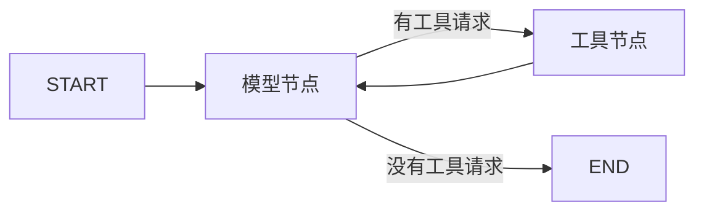

# 第一课：LangGraph 最小 Agent

当前学习目标：**用 LangGraph 表达“模型 → 工具 → 模型”的循环**。

实现保留在 [agent.py](agent.py) 一个文件中，使用真实 DeepSeek 模型和一个只读工具 `read_file`。使用 Python 3.10+；开发解释器由 `.python-version` 选择为 Python 3.14。

本课保留上一阶段的代码原样；以下命令均从仓库根目录执行，由 uv 加载根目录的本地 `.env`。

## 运行

使用 uv 管理依赖与环境。首次拉取或更新依赖后执行：

```powershell
uv sync --locked
```

保留已有的本地 `.env` 即可。首次配置时，将 `.env.example` 复制为 `.env`，填入自己的 `DEEPSEEK_API_KEY`。默认模型仍为 `deepseek-flash`，地址仍为 `https://api.deepseek.com`；环境变量优先于文件配置。

```powershell
uv run --env-file .env python -X utf8 lessons/01_minimal_langgraph/agent.py
```

默认任务：读取 `demo_workspace/notes.txt`，统计非空行数。样例包含 **4 个非空行**。指定其他任务：

```powershell
uv run --env-file .env python -X utf8 lessons/01_minimal_langgraph/agent.py "读取 notes.txt，概括文件内容"
```

工具路径相对于 `demo_workspace/`。终端显示模型调用次数、工具请求、工具结果与最终回答。`uv add 包名` / `uv remove 包名` 用于后续维护依赖；提交 `pyproject.toml` 和 `uv.lock`，不提交本地 `.venv/`。

## 第一步：状态和工具

`AgentState` 继承 `MessagesState`，保存两项内容：

- `messages`：消息历史，LangGraph 自动合并节点返回的新增消息。
- `model_calls`：模型调用次数，用来限制每个任务最多调用 6 次。

`@tool` 将 `read_file(path: str)` 转为模型可调用的工具，工具说明来自函数文档，参数说明来自类型标注。函数内部继续检查路径与读取上限。

## 第二步：两个节点和三条边

`ChatDeepSeek(...).bind_tools([read_file])` 告诉模型有哪些工具。模型节点调用它，返回新增消息与新的调用次数：

```python
return {"messages": [message], "model_calls": turn}
```

工具节点使用框架提供的 `ToolNode`，负责执行工具、将错误作为反馈，并生成带有对应 `tool_call_id` 的工具结果消息。

图的核心定义：

```python
graph = StateGraph(AgentState)
graph.add_node("model", call_model)
graph.add_node("tools", ToolNode([read_file], handle_tool_errors=True))
graph.add_edge(START, "model")
graph.add_conditional_edges("model", tools_condition)
graph.add_edge("tools", "model")
return graph.compile()
```

`tools_condition` 检查模型最后一条消息：有工具请求就去 `tools`，没有就走向结束。



## 第三步：运行图并观察结果

`run()` 调用 `graph.stream(..., stream_mode="updates")` 启动图，每完成一个节点，就收到该节点新增的状态并显示出来。这里的 `for` 循环只消费图执行事件，模型与工具之间的循环由图的边驱动。

一次常见执行顺序是：模型发出 `read_file` 请求 → 工具节点读文件 → 模型看到工具结果并回答。读取失败时，工具节点返回错误，模型可继续请求其他路径或如实说明失败。

本次真实 DeepSeek 运行已验证这条路径，共调用模型两次。终端输出摘录（省略工具返回的文件正文与最终回答中的原文）：

```text
[1] 调用模型
    工具请求：read_file {'path': 'notes.txt'}
[2] 调用模型
统计结果：文件共 5 行，其中第 3 行为空行，因此非空行数为 4 行。
```

## 当前边界

- 直接依赖为 `langgraph` 与 `langchain-deepseek`，具体版本锁定在 `uv.lock`；不需要启动额外服务。
- 工具只读练习目录中的 UTF-8 文件，每次最多 16000 字符；目录检查不是操作系统级沙箱。
- 最多调用模型 6 次；图步数还包含工具节点，通过单独的 `recursion_limit` 兜底。
- HTTP 超时默认 30 秒，SDK 重试次数设为 0；异常会使命令以非零状态退出。
- 模型返回非空文本且没有工具请求时结束；这一步没有独立的答案验收器。
- 图状态只保留在当前运行的内存中；未配置 checkpointer，没有跨进程记忆、断点恢复或额外轨迹文件。
- `.env`、已有运行记录、本地记忆与 IDE 文件不纳入提交。旧的手写循环可从 Git 历史找回。

对照阅读：[LangGraph 官方 Quickstart](https://docs.langchain.com/oss/python/langgraph/quickstart)、[ChatDeepSeek 集成](https://docs.langchain.com/oss/python/integrations/chat/deepseek)。
