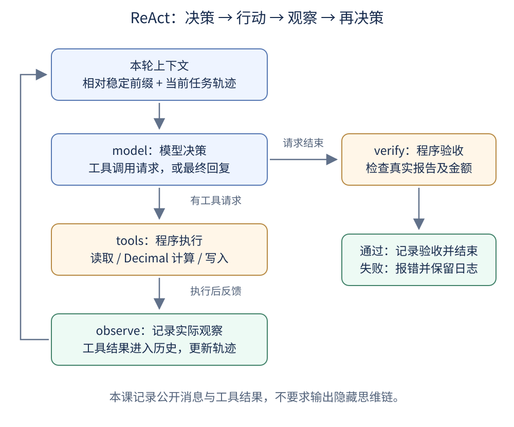

# 第六课：实现可观察的 ReAct 循环

ReAct 将推理与行动交替组织：模型依据当前信息决定下一步，程序执行工具，再把结果反馈给模型。模型根据新的观察继续决定行动，或者提出结束任务。原始方法强调推理轨迹与任务行动的结合，见 [ReAct 论文](https://arxiv.org/abs/2210.03629)。

本课把[第五课的上下文](../05_agent_context/README.md)落实成代码，沿用[第三课](../03_debugger_startup/README.md)的 LangGraph 图、真实 DeepSeek、调用次数限制和 IDE 启动兼容方式。为集中观察循环，本课使用一个 Agent 和三个收入工具，不加入子 Agent 或事件入口。旧课完整保留，本课不导入旧课代码。

## 一、先理解“想、做、看”



**读图方法：**沿左侧循环观察新结果怎样回到下一轮模型输入。右侧是本课另外增加的验收：模型提出结束，不代表程序就接受任务完成。

| 环节 | 谁负责 | 本课中的实际行为 |
| --- | --- | --- |
| 推理与决策 Reasoning | 模型 | 根据任务与历史选择读取、计算、写入或结束 |
| 行动 Acting | Python 工具 | 打开文件、进行金额计算、创建报告 |
| 观察 Observation | harness 组织反馈，模型使用反馈 | 工具返回内容或错误，进入消息历史 |

“思考”并不意味着日志必须打印完整思维链。本课关闭 DeepSeek 思考模式，使用结构化工具请求和公开结果观察 ReAct 式反馈循环，不复刻论文中的文字提示模板，也不把日志当作隐藏推理的转录。

## 二、上下文与轨迹是什么关系

在本课这种固定系统要求、固定工具集合、保留完整短历史的设置中，可以用下面的关系理解请求：

```text
本轮模型上下文 ≈ 相对稳定的前缀 + 到当前为止的任务轨迹

相对稳定的前缀：系统提示词 + 工具定义
任务轨迹：用户任务 + 模型回复/工具请求 + 工具执行结果
```

这是一种概念分解，不表示 API 必须把它们拼成一个字符串。工具定义通过绑定传入，消息历史由 `MessagesState` 管理。实际系统还可能更新工具、注入环境信息、压缩历史，所以公式不是所有 Agent 永远不变的结构。

**trajectory（轨迹）描述执行经过。**本课保存的是公开消息轨迹；完整运行日志还包括调用轮次、验收事件等元信息，不能把它们全部等同于模型上下文。

## 三、本课的文件与运行方式

```text
06_react_loop/
  agent.py                 # 模型、工具、观察、验收节点
  tools.py                 # 文件读取、Decimal 计算、报告写入与校验
  test_lesson.py           # 离线测试
  demo_workspace/
    income.csv            # 四笔教学收入
    rates.json            # 固定教学汇率
  assets/react-loop.svg   # 循环图
```

继续共用根目录 uv 环境和 `.env`，无需增加依赖。在仓库根目录运行：

```powershell
uv sync --locked
uv run --locked python -X utf8 lessons/06_react_loop/agent.py
```

PyCharm 脚本路径选择本课 `agent.py`，解释器使用根目录 `.venv`。入口在导入本课工具之前补齐脚本目录，兼容第三课遇到的 `runpy` 启动方式。

## 四、第一步：准备可以手算核对的样例

收入见 [income.csv](demo_workspace/income.csv)，汇率见 [rates.json](demo_workspace/rates.json)。所有汇率仅供本课演示，不是实时数据或财务结算依据。

| 币种 | 原币收入 | 教学汇率：每单位折合 CNY | 折合 CNY |
| --- | --- | --- | --- |
| CNY | 300.00 | 1.00 | 300.00 |
| USD | 100.00 + 50.00 = 150.00 | 7.20 | 1080.00 |
| EUR | 80.00 | 7.80 | 624.00 |
| 合计 | 不直接相加不同币种 | — | **2004.00** |

计算规则：先按币种合计，乘以对应汇率，每个币种换算结果使用 `ROUND_HALF_UP` 保留两位小数，再相加。本课明确这一口径，避免“逐笔取整”和“先合计再取整”混用。

## 五、第二步：把行动放进确定性工具

三个工具定义位于 [tools.py](tools.py)：

| 工具 | 模型提供的参数 | 程序实际做什么 |
| --- | --- | --- |
| `read_file` | `path` | 只允许读取 `income.csv` 或 `rates.json` |
| `calculate_totals` | 无 | 重新读取两份样例文件，用 Decimal 计算结果 |
| `write_report` | 无 | 将已计算的结果保存为固定路径 `output/report.json` |

计算使用十进制字符串构造 `Decimal`，关键代码为：

```python
amount = Decimal(row["amount"])
converted = (amount * rate).quantize(
    Decimal("0.01"), rounding=ROUND_HALF_UP
)
```

完整实现先按币种累计，再执行乘法。这样金额计算交给工具，而不是让模型凭文本心算或编造结果。

写入工具使用闭包保存已经计算的结果：

```python
if calculated is None:
    raise ValueError("请先调用 calculate_totals，看到计算结果后再写入")
```

随后以 `open("x")` 创建文件，拒绝覆盖。模型不能通过工具参数指定任意输出目录，也不能提交一份随意编造的报告内容。

这里的程序条件保证“先产生计算结果才能写入”。“先读取两份文件并查看反馈”的顺序主要由提示词要求；程序没有另设读取次数门控。教学工具可以批量请求，不能把提示词里的全部步骤都理解为代码已经逐项强制。

## 六、第三步：连接 LangGraph 循环

核心实现位于 [agent.py](agent.py)。沿用第三课的消息与调用次数状态，并增加验收结果字段。

模型节点的关键步骤：

```python
message = model.invoke(state["messages"])
return {"messages": [message], "model_calls": turn}
```

图的核心连接为：

```python
graph.add_conditional_edges(
    "model", tools_condition,
    {"tools": "tools", "__end__": "verify"},
)
graph.add_edge("tools", "observe")
graph.add_edge("observe", "model")
graph.add_edge("verify", END)
```

- 模型提出工具调用：转入 `ToolNode` 执行工具。
- 工具消息进入状态：`observe` 记录最新观察，不再次执行工具。
- 回到模型：它看到累积历史，再决定下一步。
- 模型没有工具请求并给出有效文本：转入 `verify`，检查实际报告。

`ToolNode` 直接注册为图节点，获取 LangGraph 所需运行上下文；观察记录放在单独节点中。工具异常使用错误消息反馈给模型，模型有机会纠正请求。

每次模型调用前检查预算，默认最多 8 次；截断、非法工具请求或空回答会终止。工具以 `max_concurrency=1` 顺序执行，图递归上限另行设置，因为图步骤还包括工具、观察和验收，不等于模型调用次数。

## 七、第四步：保存能查看的轨迹

每次运行创建独立目录：

```text
.runs/06_react_loop/<运行标识>/
  prefix.json        # 系统提示词、工具名称/描述/参数 schema
  trace.jsonl        # 每轮消息输入、模型输出、工具观察及验收事件
  trajectory.json   # 成功结束后的公开消息轨迹，不含系统消息
  validation.json   # 程序验收结果
  output/report.json
```

`prefix.json` 是前缀的教学快照，不是 SDK 发送的完整 HTTP 请求原文。`trace.jsonl` 的 `model_input` 保存当轮消息，其中包含系统消息；工具定义另见前缀快照。查看两者就能对照“相对稳定的信息”和“不断增长的历史”。

`trajectory.json` 只在成功完成后写出；中途失败时可先检查已经写入的 `trace.jsonl`。日志不保存 API 配置，所有运行产物都留在根目录忽略的 `.runs/`，不提交远程。日志可能含输入数据，使用自有数据时应按本地数据要求管理。

## 八、第五步：程序验收，而不是相信结束文字

`verify` 检查 `output/report.json` 是否存在，并重新读取源数据计算，核对报告的币种明细、汇率标记和总额。

```python
if actual != calculate_expected(source_root):
    raise ValueError("验收失败：报告与源数据计算结果不一致")
```

模型即使回复“报告已经生成”，没有实际产物也会被拒绝。校验失败会终止并记录错误，不会在本课自动重新规划。

这项验收独立于模型最终回答，但复用了计算函数，不是另一套独立算法。测试额外使用手算的 `2004.00` 与取整边界核对计算逻辑。程序检查结构化报告，不自动证明模型最终文字中的每一句解释都正确。

## 九、真实运行观察

本课已使用根目录配置的真实 DeepSeek 执行，成功轨迹如下。不同运行可能有不同的工具分组或调用轮数，下面不是固定脚本控制的模型答案。

| 模型轮次 | 调用前消息数 | 模型选择的行动 | 工具观察 |
| --- | --- | --- | --- |
| 1 | 2 | 同轮请求读取收入与汇率 | CSV 文本与教学汇率 JSON |
| 2 | 5 | `calculate_totals` | CNY 总额 `2004.00` 与各币种明细 |
| 3 | 7 | `write_report` | 实际报告创建成功 |
| 4 | 9 | 返回最终说明 | 随后程序验收通过 |

为什么消息数不是每轮只加一？第一轮产生一条包含两个工具调用的模型消息，随后产生两条工具结果，所以从 2 条变成 5 条。

成功运行的本地目录为 `.runs/06_react_loop/20261028T095526Z-6e98e045/`。终端结束输出：

```text
[验收通过] CNY 2004.00
公开轨迹已保存；实际报告：……/output/report.json
```

## 十、离线测试与练习

```powershell
uv run --locked python -X utf8 -m unittest discover -s lessons/06_react_loop -v
```

10 项离线测试全部通过：手算对照、按币种取整及非有限金额拒绝、工具路径和写入边界、完整反馈与调用 ID、错误反馈后的纠正、提前结束拒绝、报告篡改拒绝、调用上限、截断响应拒绝，以及 `runpy` 启动兼容。测试使用模拟模型，不消耗 API；真实运行使用 DeepSeek。

建议按顺序阅读：`tools.py` → `agent.py` 中的图连接 → `trace.jsonl` → `trajectory.json` → `validation.json`。

### 自测题

1. 模型请求写报告后，为什么还需要读取工具结果？
2. 工具执行返回错误，是不是 ReAct 循环就必然结束？
3. 轨迹变长是否意味着模型参数在训练？
4. 为什么“没有工具调用”不能单独证明任务成功？
5. `observe` 节点是否再次执行工具？

### 参考答案

1. 请求只说明想做什么，实际结果才说明是否成功。
2. 不一定。工具错误可以反馈给模型，模型在预算内决定纠正或结束；不可恢复异常也可以直接终止。
3. 不是。本课是把新观察加入上下文，未更新模型参数。
4. 模型可能提前结束，需要检查报告等任务证据。
5. 不会。它只记录 `ToolNode` 已经产生的工具消息。

## 本课边界

这是固定样例任务的 ReAct 式实现，不是任意文件、任意币种和实时汇率服务；输入是受控教学文件，读取白名单不构成操作系统沙箱。没有跨会话恢复、历史压缩、自动重试、总 token 预算或通用财务规则。调用轮数有上限，网络请求有超时；没有打印或要求模型公开隐藏思维链。
