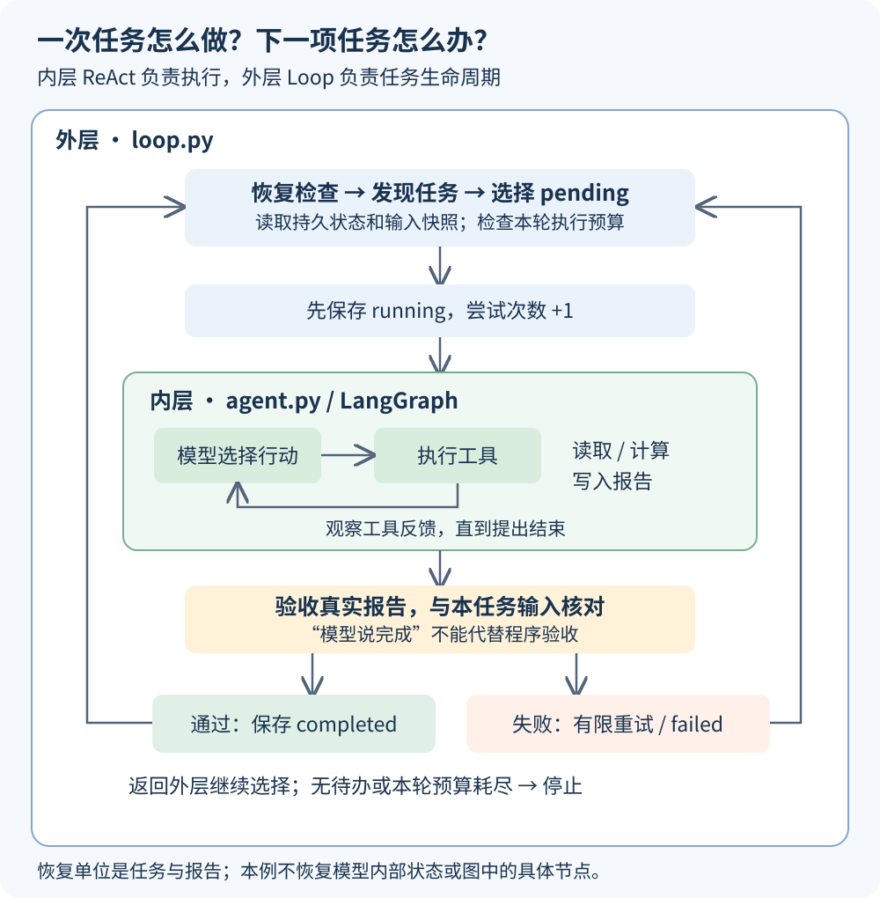
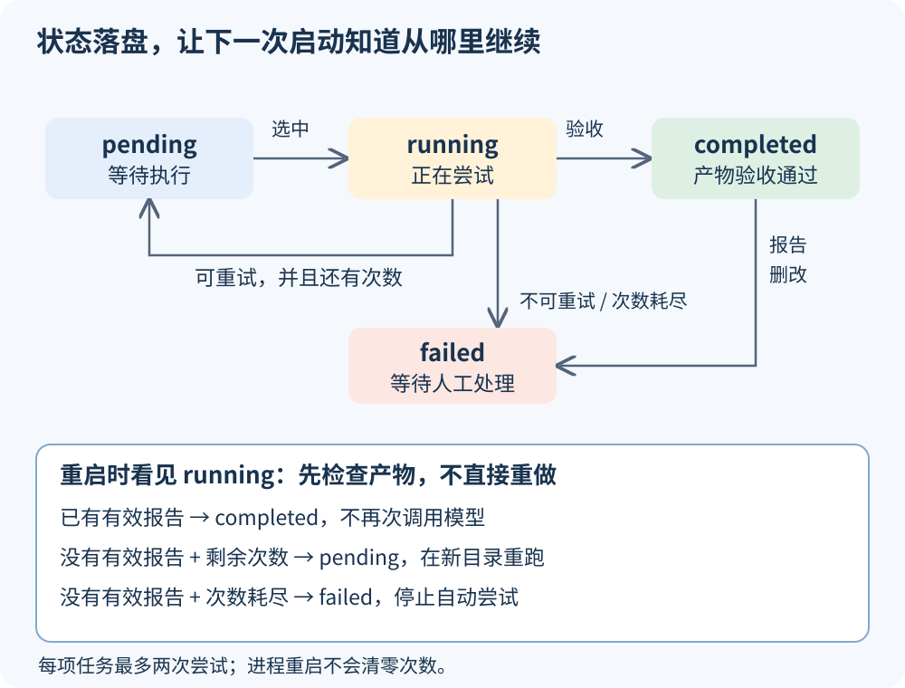

# 第七课：把一次 ReAct 执行放进可恢复的任务循环

第六课解决“这一项任务怎么做”：模型选择工具，读取收入、计算金额、生成报告。本课继续使用真实 DeepSeek 和 LangGraph，在外面增加任务管理：**从哪里发现任务、接下来做哪项、怎样验收、失败怎么办、重启后怎么继续、什么时候停止。**

这是原文语境下 Loop 工程的一个本地最小示例；它不要求多 Agent，也没有让模型自行扩展目标。固定汇率是教学数据。



## 1. 先看运行效果

在仓库根目录运行。继续使用已有根目录 `.env`，不新增依赖，不复制密钥。

```powershell
uv sync --locked

# 第一次：最多启动一次任务尝试，做完十月就停
uv run --locked python -X utf8 lessons/07_loop_engineering/loop.py --max-executions 1

# 第二次：读取相同状态目录，继续十一月
uv run --locked python -X utf8 lessons/07_loop_engineering/loop.py --max-executions 1

# 第三次：重新验收已有报告，两个任务都完成，不再调用模型
uv run --locked python -X utf8 lessons/07_loop_engineering/loop.py --max-executions 1
```

在一个全新状态目录上，三个命令的关键结果如下。模型每次的措辞和工具编排可能不同。

| 启动 | 启动任务尝试次数 | 已完成 | 待执行 | 停止原因 |
| --- | ---: | ---: | ---: | --- |
| 第一次 | 1 | 1 | 1 | `execution_budget`：本轮预算用完 |
| 第二次 | 1 | 2 | 0 | `no_pending_tasks`：没有可执行待办 |
| 第三次 | 0 | 2 | 0 | `no_pending_tasks`，零模型调用 |

样例手工核对结果：十月 `300 + 150 × 7.20 + 80 × 7.80 = 2004.00 CNY`；十一月 `100 + 20 × 7.20 = 244.00 CNY`。

本次真实 DeepSeek 验证中，两项任务各进行了 4 次模型调用、4 次工具调用；第三次启动执行次数为 0，两个报告均再次通过验收。失败与中断路径使用下文的离线测试验证。

如果默认目录已完成，可以换一个**未使用的**状态目录重新体验，保留原来的运行记录：

```powershell
uv run --locked python -X utf8 lessons/07_loop_engineering/loop.py --work-dir .runs/07_loop_engineering/practice-01 --max-executions 1
```

后续继续使用同一个 `--work-dir` 才会恢复同一批状态；换目录代表开启另一次独立实验，会重新调用模型。

## 2. 对照第六课，新增了什么

```text
07_loop_engineering/
├── agent.py                 # 内层：第六课 LangGraph ReAct，小幅修改
├── tools.py                 # 计算、写报告、验收；区分验收失败异常
├── loop.py                  # 新增：外层任务管理，优先阅读
├── demo_inbox/
│   ├── 01_october/           # income.csv + rates.json
│   └── 02_november/          # 第二项任务，数据不同
├── test_lesson.py           # 保留第六课的十项回归测试
├── test_loop.py             # 本课任务生命周期测试
└── assets/                  # 两张流程图
```

本课独立保存代码，不导入或修改第六课。建议先读下面几步，再读 `loop.py` 全文；文件锁、状态写入和命令行解析是辅助代码，核心在 `run_loop()`。

| 问题 | 内层 ReAct：`agent.py` | 外层循环：`loop.py` |
| --- | --- | --- |
| 接下来做什么？ | 调哪个工具、传什么参数 | 选哪项任务、是否重试 |
| 状态是什么？ | 当前任务的消息、工具反馈、模型调用次数 | 多项任务的状态、总尝试次数、产物位置 |
| 怎样结束？ | 模型提出结束，图节点验收报告 | 没有待办，或本轮执行预算用完 |
| 失败怎样处理？ | 工具错误可以反馈给模型 | 有限重试、恢复检查或记为失败 |
| 是否跨进程恢复？ | 本课不恢复图内节点或消息 | 读取 JSON 状态，检查报告后决定跳过或重跑 |

## 3. 第一步：让原来的 Agent 接受不同输入

第六课输入目录固定。本课把目录变成程序参数，模型仍然只能读取两份指定文件：

```python
# agent.py：真实签名，下面摘取函数内的两行
def run(config: dict, task: str = DEFAULT_TASK, run_dir: Path | None = None,
        max_turns: int = 8, source_root: Path = SOURCE_ROOT) -> dict:
    tools = create_tools(run_dir, source_root)
    graph = build_graph(config, tools, run_dir, max_turns, source_root)
```

完整函数在 `agent.py`。`source_root` 同时传给工具和验收函数，保证它们处理同一项任务。目录由外层程序设置，不交给模型选择。

工具仍然是三个：`read_file`、`calculate_totals`、`write_report`。LangGraph 内部仍按 `model → tools → observe → model` 循环，模型结束后进入 `verify`。

## 4. 第二步：发现任务，并固定本次输入

一个收件子目录就是一项任务，必须同时包含 `income.csv` 和 `rates.json`。不完整的目录会被提示并忽略。

`discover()` 的身份计算代码：

```python
content = {name: (folder / name).read_bytes() for name in FILES}
identity = [folder.name, *[sha256(content[name]).hexdigest() for name in FILES]]
task_id = sha256(json.dumps(identity, ensure_ascii=False).encode("utf-8")).hexdigest()
if task_id in state["tasks"]:
    continue
```

这里的任务身份由“子目录名称 + 两份文件的原始字节内容”共同决定：相同名称、相同内容不会重复入队；同名内容改变会成为新任务。仅改空白、换行或重命名目录也会成为新任务，这不是业务层的订单去重。

发现任务后，将已读取的数据写入 `.runs/.../tasks/<task_id>/input/`，作为输入快照。重试和验收始终读取该快照；收件目录随后发生变化，不会悄悄改变已有任务。

生产者应先在收件目录外准备好两份文件，再将完整目录移入。本例不会等待并发写入完成，也不保证两次文件读取属于上游的同一个事务。

## 5. 第三步：把任务进度保存成状态机



每项任务有四种状态：

| 状态 | 含义 | 会被选中执行吗？ |
| --- | --- | --- |
| `pending` | 等待首次执行或允许重试 | 会 |
| `running` | 已保存执行意图，某次尝试正在进行 | 重启时先恢复检查 |
| `completed` | 报告实际通过验收 | 跳过模型执行，重新检查产物 |
| `failed` | 输入不合法、不可重试、预算耗尽或完成产物异常 | 不会，等待人工处理 |

例如第一次运行后，`state.json` 中一条记录类似：

```json
{
  "name": "01_october",
  "status": "completed",
  "attempts": 1,
  "last_error": null,
  "report": "实际运行目录/attempt-1/output/report.json",
  "total_cny": "2004.00"
}
```

`transition()` 先保存状态，再写事件日志。`persist()` 先写同目录的 `state.tmp`，再替换 `state.json`，避免直接覆盖造成半份 JSON。损坏的状态文件会导致停止，不会默默当成全新队列。这里未实现断电级持久性保障。

同一状态目录加操作系统文件锁，拒绝第二个调度进程进入；锁文件可以一直存在，进程退出后锁由操作系统释放。它不是多机分布式锁。

## 6. 第四步：外层选择任务，调用内层 ReAct，再验收

下面摘取 `run_loop()` 的核心顺序，省略异常分支和预算检查：

```python
reconcile(work_dir, state)                    # 先恢复和检查已有任务
discover(inbox, work_dir, state)              # 再发现新任务
# 从 pending 任务中选择；优先选择还没尝试的任务
transition(work_dir, state, task_id, "running", attempts=task["attempts"] + 1)
worker(config, task=DEFAULT_TASK + feedback,
       run_dir=directory, source_root=snapshot)
validation = validate_report(directory, snapshot)
transition(work_dir, state, task_id, "completed",
           report=validation["report"], total_cny=validation["total_cny"], last_error=None)
```

默认 `worker` 就是 `agent.run`，会调用真实 DeepSeek。测试时可以替换 worker，从而不消耗 API 验证调度机制。

注意顺序：**先保存 running，再执行；先验收真实文件，再保存 completed。**模型或 worker 返回一段“成功”文本，不足以让任务通过。

外层验收不信任内层返回的 `validation` 字段，而是再读取文件与快照核对。不过两层复用了同一套计算算法，并不是两个相互独立的计算实现；手工金额测试用于补充这一局限。

## 7. 第五步：失败和中断，分别处理

| 情况 | 本课处理 |
| --- | --- |
| 输入金额无效、汇率缺失等 | 调用模型前失败，不自动修改输入 |
| 结束时报告不存在、JSON 无效或内容不符 | `VerificationError`，在剩余预算内重试 |
| SDK 连接异常（含超时）、500 错误、限流 | 在剩余预算内重试；重试前固定等待 1 秒 |
| 权限、认证、其他程序异常 | 记录异常类型并标记失败，不盲目重试 |
| 上次停在 running，已有报告通过验收 | 直接恢复为 completed，不再调用模型 |
| 上次停在 running，无有效报告 | 有剩余次数则 pending，否则 failed |
| 已完成任务的报告被删除或篡改 | 标记 failed，等待处理，不悄悄重做 |

每项任务最多 **2 次尝试**，次数跨重启保留；每次尝试使用 `attempt-1/`、`attempt-2/` 独立目录，不覆盖旧产物。失败反馈会加入下一次的用户任务消息。若可重试异常后留下了可验收的报告，外层在下轮调度前也会先认领该产物。

内层单次仍最多调用模型 8 次；外层 `--max-executions` 控制**本次进程最多启动几次任务尝试**，重试也占一次。它们都不是严格的费用或总运行时长上限。

这里的“恢复”是**任务级恢复**：检查现有产物，或在新目录重新执行整个任务；没有恢复 LangGraph 的具体节点、网络连接或模型内部状态。

本例只在本地生成报告。真实扣款、退款、发消息等有外部副作用的工具，必须先查状态并使用服务端幂等机制，不能照搬“超时就重跑整个任务”。本例也没有承诺 exactly-once 执行。

## 8. 怎样查看过程

```text
.runs/07_loop_engineering/default/
├── state.json                   # 持久任务状态，重启恢复依据
├── summary.json                 # 最近一次进程的停止原因与统计
├── trace.jsonl                  # 外层任务状态变化与停止事件
├── runner.lock                  # 操作系统文件锁载体，不是状态标志
└── tasks/<完整 task_id>/
    ├── input/                   # 本任务冻结的两份输入
    ├── attempt-1/
    │   ├── prefix.json          # 系统提示和工具说明
    │   ├── trace.jsonl          # 模型输入、公开回复、工具结果、验收
    │   ├── trajectory.json      # 成功运行后的公开消息轨迹
    │   ├── validation.json
    │   └── output/report.json
    └── attempt-2/               # 仅发生第二次尝试时创建
```

外层 `state.json` 是跨任务的程序状态，不会整体塞给模型；模型每次只收到当前任务的系统提示、工具定义、消息历史，以及可能存在的失败反馈。

所有运行文件都位于被 Git 忽略的 `.runs/`。网络异常只把异常类型保存到外层状态，不复制服务端响应体或 API 配置；内层轨迹包含实际任务数据，只适合保留在本地。

## 9. 验证与阅读练习

```powershell
uv run --locked python -X utf8 -m unittest discover -s lessons/07_loop_engineering -v
```

测试使用真实临时文件和状态，模型调用替换为可控回复。保留前课 10 项测试，新增 17 项，共 27 项；覆盖去重、输入变化、执行预算、验收反馈、连接异常和有限重试、两类中断恢复、非法输入、异常信息、产物篡改、空目录、损坏状态、跨进程文件锁，以及外层到实际 LangGraph 的集成路径。真实 DeepSeek 的正常路径另外运行验证。

可以按顺序做三个练习：

1. 三次用 `--max-executions 1` 启动，比较 `state.json` 和终端，解释第三次为什么零模型调用。
2. 在自己的实验收件目录里复制一份任务并改名，重新启动，观察新增任务；再修改其中金额，观察同名新版本与原快照并存。
3. 阅读 `test_report_written_before_interrupt_is_adopted_without_second_worker`，理解“生成报告后中断”为什么不必再次运行 Agent。失败与中断的可重复演示放在测试中，不向真实模型故意制造付费故障。

本课是本地、单调度进程、小文件教学实现：目录内容会读入内存，状态会整体重写；没有常驻监听、定时器、任务取消、多机队列、图内检查点或跨运行自动修改 Harness。无待办时直接停止；出现 failed 时命令退出码为 1，即使停止原因为 `no_pending_tasks` 也不能解读为全部成功。执行预算用完但仍有 pending 时退出码为 0，表示本轮正常让出，是否全部完成要看 summary 的计数。

资料：[LangGraph Graph API](https://docs.langchain.com/oss/python/langgraph/graph-api)、[Python 3.14 文件替换](https://docs.python.org/3.14/library/os.html#os.replace)。本课的 JSON 外层调度是教学实现，不是 LangGraph 的持久执行或 checkpointer 功能。
