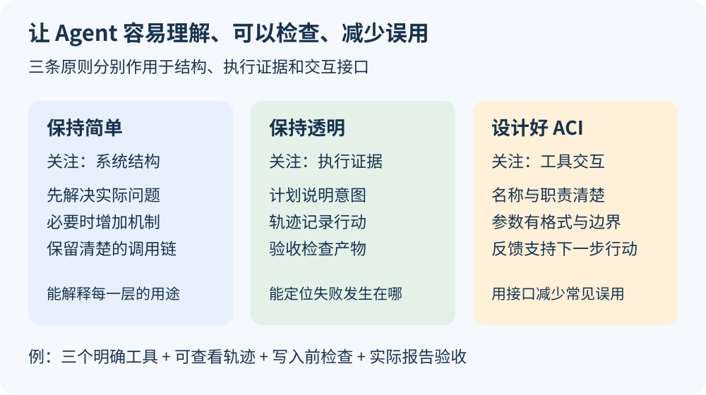
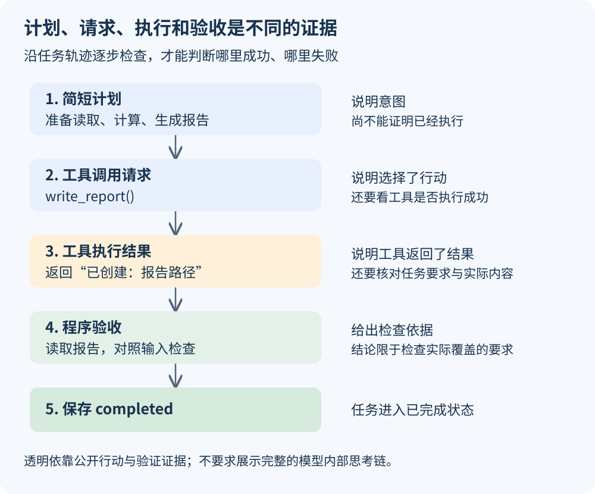
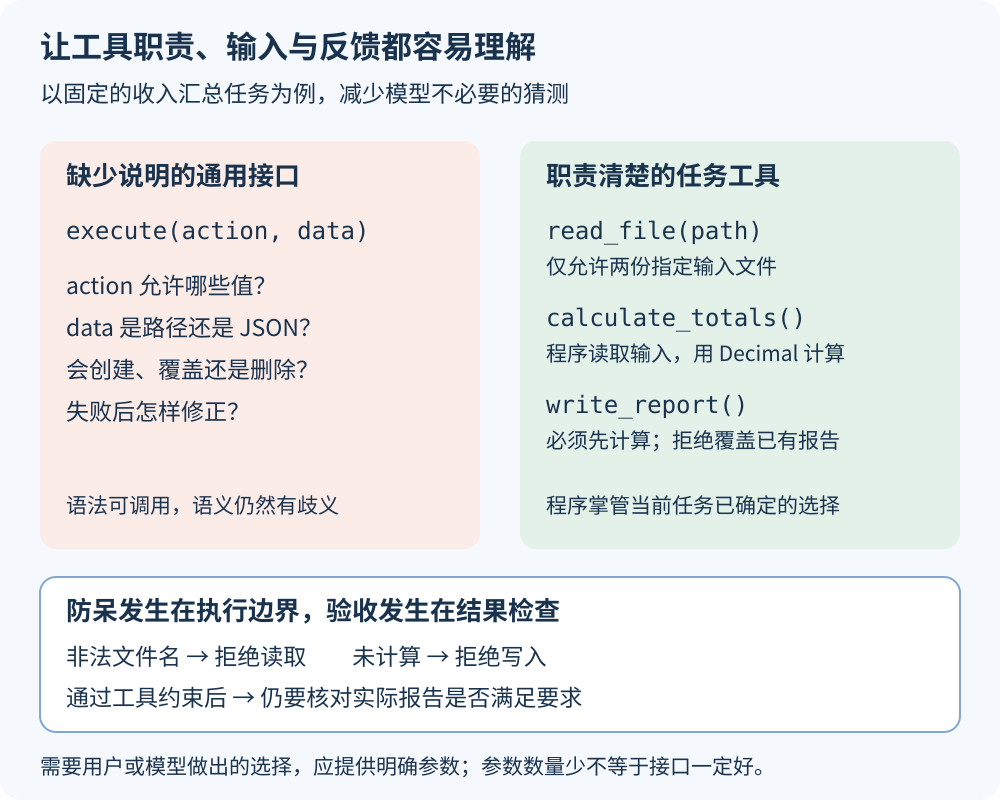

# 第八课：保持简单、保持透明与设计好 ACI

前几课已经让 Agent 读取文件、使用工具、验收报告，并通过外层 Loop 接续任务。这一课回看这些设计：哪些机制值得加入？执行过程怎样才能查清楚？工具怎样才能让模型少犯错？

本课的三个目标是：能解释一个抽象的用途，能用执行证据判断任务进度，能发现工具接口中的歧义与误用风险。以下例子继续使用第七课的收入汇总 Agent；本课提供图解、代码阅读和练习，不增加运行程序或依赖。



## 1. 保持简单：为已经存在的问题增加机制

假设任务是读取固定收入文件、按固定汇率计算、输出报告。如果流程完全确定，普通 Python 函数就能完成；需要识别用户意图、选择操作或应对不确定反馈时，再把模型放在相应决策点。课程中的模型与工具循环用于学习 Agent，并不代表任何计算任务都需要模型。

“简单”可以从三个角度判断：流程是否容易追踪，数据由谁管理是否明确，出错时是否容易定位。代码行数少只是其中一个参考。

| 当前遇到的问题 | 可以加入的机制 | 在已有课程中的位置 |
| --- | --- | --- |
| 模型需要根据工具结果决定下一步 | 模型与工具的反馈循环 | 第六课 ReAct |
| 模型声称结束，但报告可能不存在 | 程序验收实际文件 | 第六、七课 `validate_report` |
| 重启后不知道哪些任务已经做完 | 持久任务状态与恢复检查 | 第七课 `state.json`、`reconcile` |
| 同一状态目录被两个进程同时处理 | 进程互斥锁 | 第七课 `single_runner` |

这些复杂度各有对应的问题。反过来，如果只是读取一个小文件，预先加入多 Agent、分布式队列和插件系统，可能会增加需要解释和维护的行为。

Anthropic 在《Building effective agents》中建议从最简单的可行方案开始，并提醒框架抽象可能遮挡实际提示与响应。这里的判断标准是需求和可理解性，并不是“使用框架就不简单”。[原文](https://www.anthropic.com/research/building-effective-agents)

### 为什么多一层抽象可能增加调试盲区

例如，报告没有写入时，你需要沿调用链检查：

```text
用户任务
  → 实际发给模型的消息
  → 模型返回的工具名和参数
  → 框架解析与分发
  → 工具执行
  → 文件写入及验收
```

如果只看最外层的“执行失败”，中间哪个环节出了问题就不清楚。合理的封装可以减少重复代码，但应保留查看输入、输出和异常的入口。

你现在使用的 LangGraph 将流程表达为节点与边。阅读 [agent.py](../07_loop_engineering/agent.py) 时，可以直接找到 `model`、`tools`、`observe`、`verify`，再看相应消息与事件记录，这有助于理解框架实际执行了什么。

### 加功能前，先回答三个问题

1. 它解决哪个已经出现的问题？例如“重启重复做任务”。
2. 怎样验证它发挥了作用？例如“第二次启动不再调用已完成任务的模型”。
3. 加入后还能看清输入、输出、状态和停止条件吗？

保持简单也包括保留必要保障。删除验收检查虽然能减少几行代码，却会让系统更难判断任务是否完成。

## 2. 保持透明：用证据区分计划、执行与完成

一句“报告已完成”只是一段输出。要了解任务是否真的完成，需要看到行动及其实际结果。



下面是教学日志示意，用来解释每类信息的作用，不是一次新运行的输出：

```text
[任务] 处理十月收入
[行动请求] read_file {"path": "income.csv"}
[观察] 收到收入文件内容
[行动请求] calculate_totals {}
[观察] total_cny = 2004.00
[行动请求] write_report {}
[观察] 已创建报告文件
[验收通过] 报告与输入计算结果一致
[任务] completed
```

| 记录内容 | 能说明什么 | 单凭它还不能说明什么 |
| --- | --- | --- |
| 简短计划 | 准备采取哪些步骤 | 步骤已经执行 |
| 工具调用请求 | 模型选择了什么工具和参数 | 工具已经成功执行 |
| 工具执行结果 | 工具返回了什么 | 整个任务已经满足要求 |
| 验收记录 | 产物通过了哪些程序检查 | 未检查的要求也一定正确 |
| 完成状态 | 调度程序记录任务已完成 | 产物之后永远不会被删改 |

因此，透明不是多打印一些文字，而是让状态变化有对应证据，且能够追溯。

### 透明需要展示什么

对用户，可以提供简短计划、当前进度、结果和需要处理的问题。对开发者，可以记录模型输入、公开回复、工具名称与参数、返回值、异常类型、调用标识、验收结果，以及停止原因。

无需把模型完整的内部思考链当作日志要求。公开的行动说明、工具记录和验证依据，已经能够回答许多排查问题；模型生成的理由说明本身也需要与实际行为核对。密钥与敏感配置不应出现在执行日志中。

### 对应到第七课

| 文件或函数 | 作用 |
| --- | --- |
| 每次尝试的 `prefix.json` | 查看系统提示与工具定义 |
| 每次尝试的 `trace.jsonl` | 查看模型请求、公开响应、工具结果及验收事件 |
| 成功尝试的 `trajectory.json` | 查看公开消息轨迹，工具结果通过调用标识与请求对应 |
| 外层 `state.json` | 查看任务状态、尝试次数及产物位置 |
| 外层 `summary.json` | 查看本次进程执行次数、状态统计与停止原因 |
| `validate_report` | 检查实际报告，而非依赖模型最后一句话 |

这些记录解决的问题不同。外层状态不等于模型上下文，模型结束也不等于任务已验收。第七课没有单独的结构化计划事件，工具轨迹也不应被称为完整思考过程。

## 3. 设计好 ACI：让工具容易选、参数容易填、结果容易理解

ACI 是 Agent-Computer Interface，即 Agent 与计算机环境交互的接口设计。在工具调用场景中，它包括模型可见的工具名称、描述、参数格式，以及执行后返回的结果和错误反馈。

传统 API 同样需要清楚的设计；ACI 更强调模型作为使用者的需求：模型能否依据当前看到的说明选对工具、构造有效参数、理解执行反馈并继续行动？SWE-agent 的研究把语言模型视为一类具有自身需求的软件使用者，研究了接口设计对其行为与任务表现的影响。[论文](https://arxiv.org/abs/2405.15793)



### 从一个难以理解的接口开始

下面只是一个存在歧义的签名示意：

```python
def execute(action: str, data: str) -> str:
    ...
```

如果没有进一步说明，模型需要猜测 `action` 的合法值、`data` 的格式、执行副作用，以及返回字符串的含义。工具多了之后，名称和描述重叠还可能让模型选错工具。

对于本课延续的固定任务，第七课使用三个工具：

| 工具 | 模型提供什么 | 程序管理什么 |
| --- | --- | --- |
| `read_file(path: str)` | 两个指定文件名之一 | 实际输入目录与读取边界 |
| `calculate_totals()` | 无参数 | 收入来源、教学汇率、Decimal 计算与计算结果 |
| `write_report()` | 无参数 | 输出目录、报告内容、写入前置条件及禁止覆盖 |

参数减少，是因为这个任务中的一些选择已经由程序确定。若产品确实支持多个输出目标，就应提供相应参数，并说明格式、范围与影响。工具是否合适，应结合任务判断。

### ACI 不止是给工具起名字

| 设计点 | 要回答的问题 | 收入 Agent 中的做法 |
| --- | --- | --- |
| 名称与职责 | 什么情况下应选择这个工具？ | 读取、计算、写报告分开表达 |
| 参数 | 哪些字段必填？格式和合法范围是什么？ | `path` 只允许两个指定文件名 |
| 前置条件 | 哪些操作必须先发生？ | 写报告前必须存在计算结果 |
| 副作用 | 会创建、覆盖、删除还是发送什么？ | 在本次尝试目录创建报告，已存在则拒绝覆盖 |
| 返回结果 | 完成了什么？结果在哪里？ | 计算返回 JSON 字符串，写入返回实际路径 |
| 错误反馈 | 为什么失败？下一步怎么做？ | 提示先调用 `calculate_totals` |

需要区分当前实现与一种后续改进：第七课的 `write_report` 返回人类可读字符串；若以后需要程序消费更多结果，可以考虑稳定的结构化字段，如 `status` 和 `report_path`。这不是本课新增的工具行为。

## 4. 防呆：把常见误用挡在执行边界

防呆（Poka-yoke）的思路是通过设计减少特定错误出现的机会，或在错误进入后续流程前将其发现。软件中的典型做法是限制合法输入、检查前置条件、避免意外覆盖，并提供明确反馈。

下面两段直接摘自第七课 [tools.py](../07_loop_engineering/tools.py)：

```python
# read_file：模型不能通过路径参数读取任意文件
if path not in {"income.csv", "rates.json"}:
    raise ValueError("只能读取 income.csv 或 rates.json")
```

```python
# write_report：没有计算结果，就不执行写入
if calculated is None:
    raise ValueError("请先调用 calculate_totals，看到计算结果后再写入")
```

前者限制参数取值，后者检查程序状态。模型即使没有遵守提示词，工具也会拒绝不符合条件的调用；错误结果随后可以成为下一步修正的依据。

这里有一个细节：`calculated is None` 只能证明“程序还没有计算结果”。它不能证明模型已经阅读并理解了计算反馈；代码中的提示措辞不等于额外的强制检查。

| 保障方式 | 在当前项目中的例子 |
| --- | --- |
| 提示指引 | 系统提示要求先读取、再计算、再写入 |
| 工具约束 | 文件名白名单、计算前置检查、`open("x")` 禁止覆盖 |
| 结果验证 | 报告内容与快照数据计算结果比较 |
| 失败纠正 | 工具错误进入消息历史；外层按类型与预算决定是否重试 |

防呆防住的是具体错误类别，不会消除全部错误。例如，禁止覆盖能保护旧文件，但不能证明计算算法正确；验收与计算复用算法时，也可能共享同一个计算缺陷，因此前课还保留了手工金额对照测试。

## 5. 用三个原则复盘第七课

| 原则 | 已有设计 | 阅读时关注什么 |
| --- | --- | --- |
| 简单 | 内层负责一项任务，外层负责调度；三个工具有明确职责 | [agent.py](../07_loop_engineering/agent.py) 的节点与 [loop.py](../07_loop_engineering/loop.py) 的主循环 |
| 透明 | 轨迹、任务状态、验收与停止统计分别保存 | `record`、`transition`、`summary` 的写入位置 |
| ACI 与防呆 | 工具说明、有限参数、前置条件、错误反馈 | [tools.py](../07_loop_engineering/tools.py) 中的三个工具 |

可以沿一条错误路径阅读：模型提前调用 `write_report` → 工具拒绝 → ToolNode 返回错误消息 → 模型看到反馈后重新选择工具。再沿另一条路径阅读：模型声称完成但没有报告 → `validate_report` 拒绝 → 外层依据剩余尝试次数决定下一步。

如果本地已有第七课运行记录，可以直接查看 `.runs/07_loop_engineering/default/`，本课无需再次调用 API。

## 6. 自测与参考答案

先独立回答，再看后面的参考答案。

1. 读取固定 CSV 并求和，为什么不一定需要 Agent？
2. 引入框架后，要能看见哪些信息，才容易排查工具调用失败？
3. 日志里出现 `write_report` 请求，是否证明报告生成？
4. 为什么当前 `write_report()` 不接收模型提供的报告内容？
5. “请不要覆盖文件”与 `open("x")` 有什么区别？
6. 工具返回“报告已生成”，为什么还要验收？
7. 所有工具都没有参数，是否就是最好的 ACI？
8. 展示完整内部思考链是否是保持透明的必要条件？

参考答案：

1. 输入、计算规则与输出都确定时，普通代码即可执行；需要模型判断的环节应有具体用途。
2. 实际模型消息、工具定义、模型输出的名称与参数、分发后的输入、工具结果和异常，以及必要的状态变化。
3. 不能。请求表示行动选择，还要看工具执行结果和实际产物。
4. 当前报告由确定性计算结果生成，程序掌管内容可减少模型重新组织数据时产生的错误。
5. 前者是指令，后者是执行时的行为约束：目标已存在就拒绝创建。
6. 工具反馈与任务验收针对的范围不同；还要核对内容、输入版本和任务要求。
7. 不是。需要选择的内容应提供明确参数，已经确定的内容可以由程序管理。
8. 不是。公开行动说明、执行记录与验证证据能够提供可检查的透明度，日志还要避免泄露敏感数据。

## 7. 延伸阅读

- [Anthropic：Building effective agents](https://www.anthropic.com/research/building-effective-agents)：简单可组合的模式、框架抽象与工具设计。
- [SWE-agent：Agent-Computer Interfaces Enable Automated Software Engineering](https://arxiv.org/abs/2405.15793)：从模型使用者的需求出发研究软件交互接口。
- [第六课：ReAct 循环](../06_react_loop/README.md)、[第七课：Loop 工程](../07_loop_engineering/README.md)：对照运行代码理解工具反馈、验收和任务恢复。
